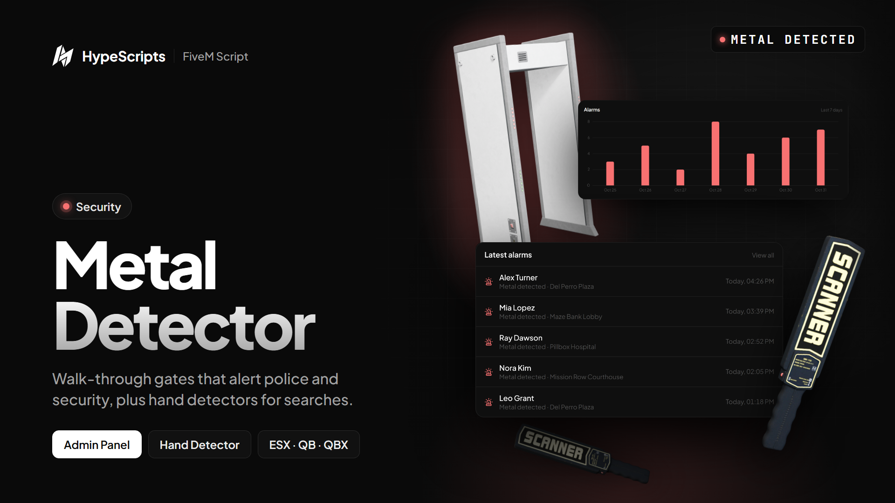
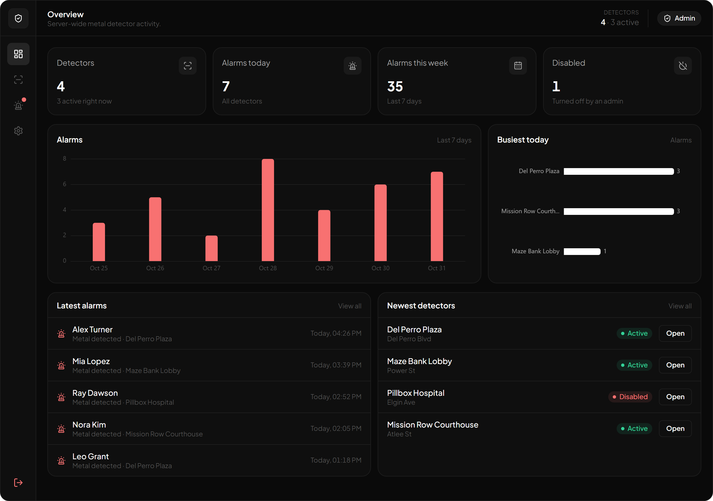
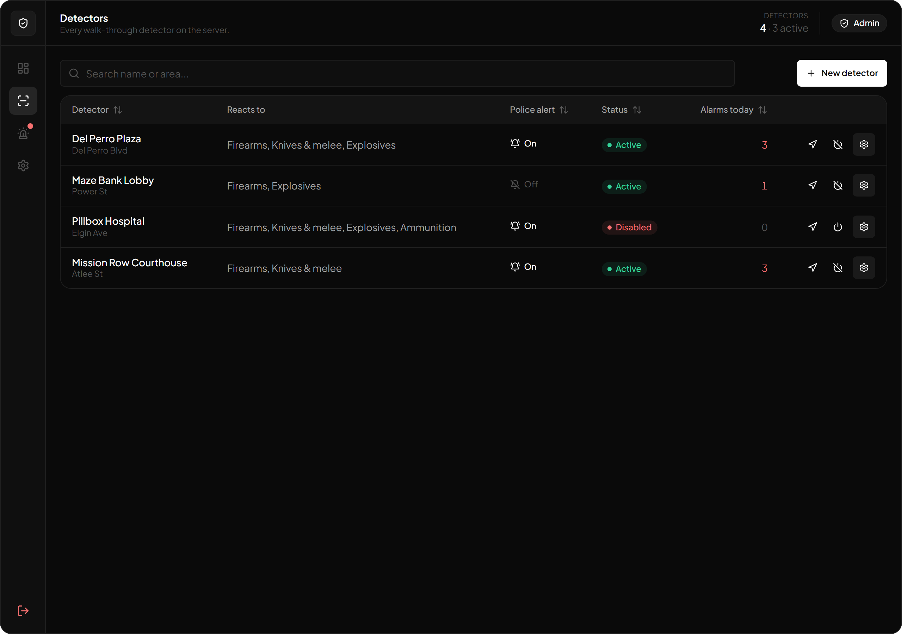
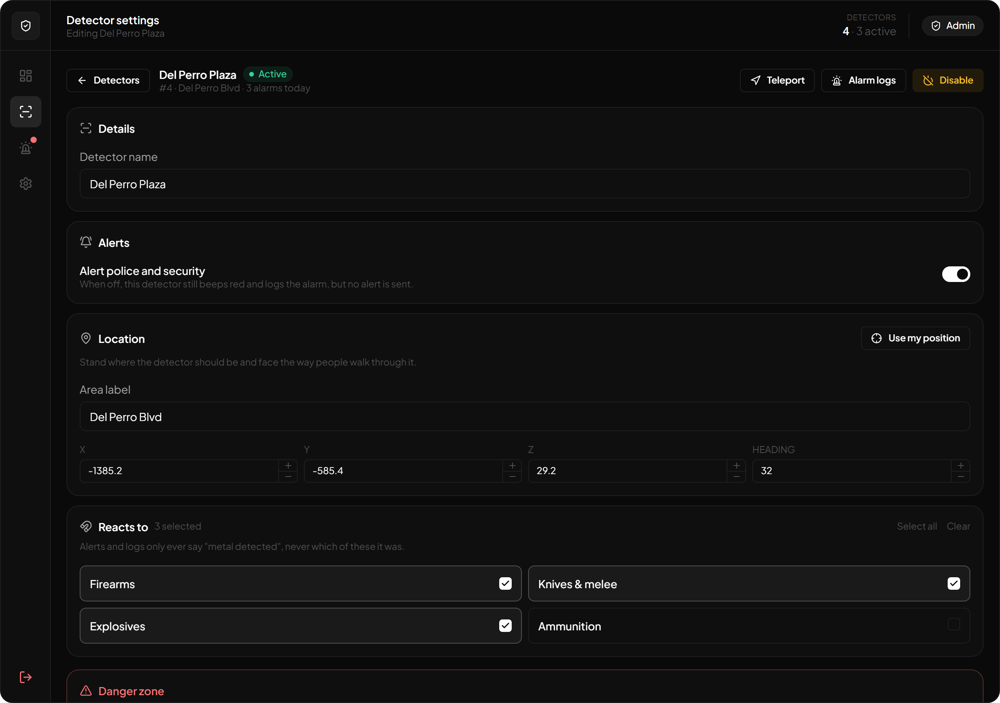
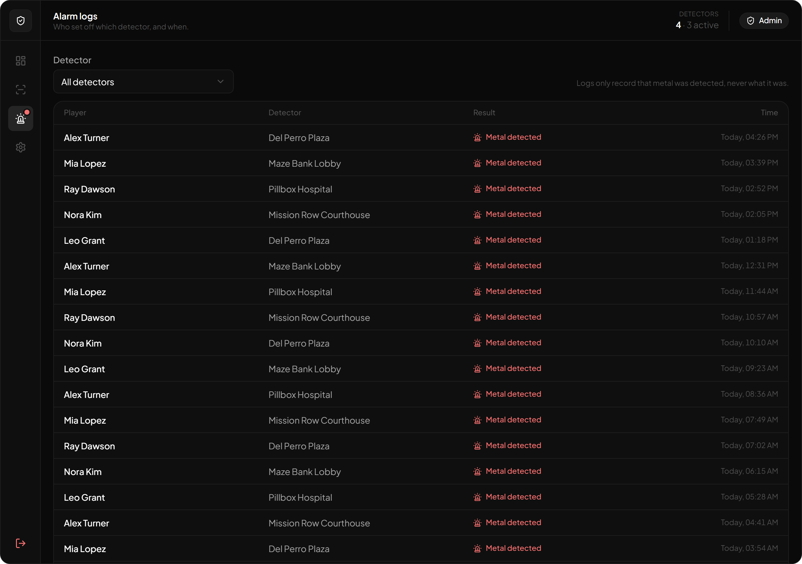
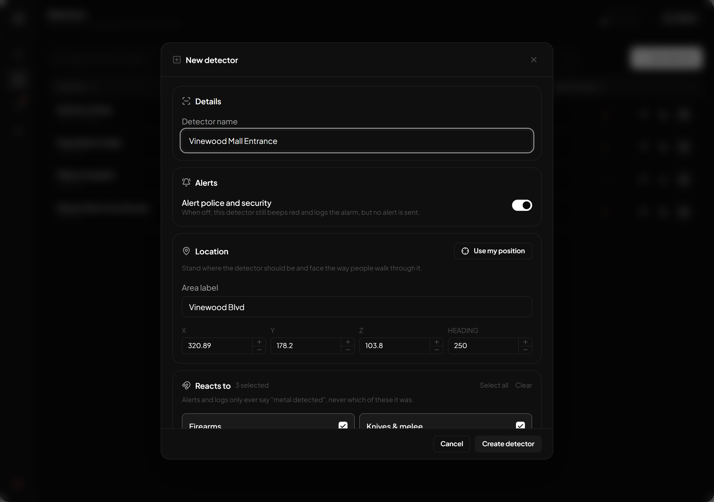
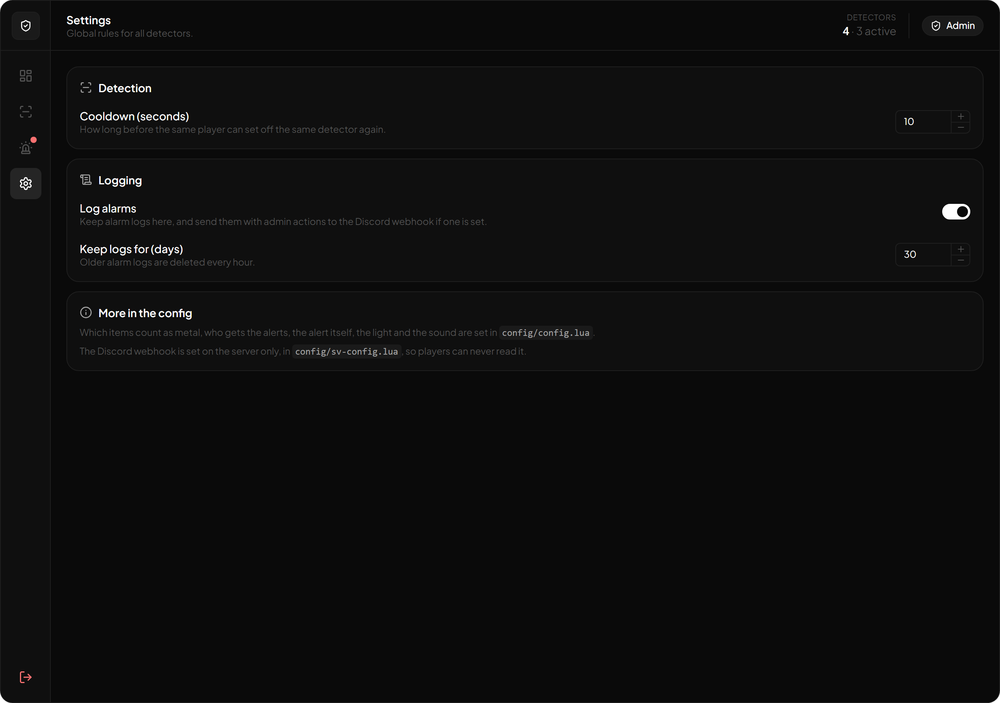

<div align="center">



# hype-dedector

**Walk-through metal detectors and a handheld detector for FiveM**

Admins place detector gates anywhere from an in-game panel. When a player carrying metal walks through, the gate lights up red, beeps for everyone nearby and alerts police and security. Officers can also search a player by hand with a handheld detector. In line with roleplay rules, every result only says "metal detected" or "clean", never what was found.


[Features](#features) · [Screenshots](#screenshots) · [Installation](#installation) · [Configuration](#configuration) · [Commands](#commands) · [Admin panel](#admin-panel)

</div>

---

## Features

- **Walk-through detectors** placed, edited, moved, disabled and deleted from the admin panel. Props are spawned only for nearby players.
- **Rotated trigger box** per gate. Only walking *through* the gate counts, the path between two checks is traced so sprinting can't skip it, and vehicles are ignored by default.
- **Server-side scan.** The client only reports which gate it crossed; distance, cooldown, job and the whole inventory are checked on the server.
- **Metal categories** (firearms, knives & melee, explosives, ammunition) with exact item names, Lua patterns and a non-metal list. Each gate picks the categories it reacts to.
- **Light and sound** on every pass: red with an alarm beep on metal, green when clean, for everyone within `Config.Feedback.radius`.
- **Police and security alerts** with a notification and a temporary map blip, or your own dispatch (ps-dispatch, cd_dispatch and core_dispatch examples included). Alerts can be turned off per gate.
- **Job exemptions** (on-duty police and security pass green) plus a `ShouldScan` hook for your own exceptions, such as a weapon license.
- **Handheld detector.** Search a player through ox_target / qb-target or by using the item. The searcher walks around the player with the prop in hand while the player holds their hands up.
- **Admin panel** (Vue NUI): overview with stats, a 7-day alarm chart, the busiest gates today, latest alarms and newest detectors; detector list with search and teleport; alarm logs filtered per detector; global settings.
- **Alarm logs** in the database with automatic cleanup, and optional Discord webhook logs for alarms and admin actions. The webhook lives in a server-only file.
- **Prop placement tool** to line the hand detector up in the hand and print the config values.
- **Automatic SQL**: the tables are created on first start.
- **ESX, QBCore and Qbox** detected automatically, no core resource needed. English and Turkish locales included.

## Screenshots

<table>
  <tr>
    <td width="50%"></td>
    <td width="50%"></td>
  </tr>
  <tr>
    <td align="center"><sub>Overview with stats and the alarm chart</sub></td>
    <td align="center"><sub>Every detector with search and teleport</sub></td>
  </tr>
  <tr>
    <td></td>
    <td></td>
  </tr>
  <tr>
    <td align="center"><sub>Editing a detector</sub></td>
    <td align="center"><sub>Alarm logs filtered per detector</sub></td>
  </tr>
</table>

<details>
<summary><b>More screenshots</b></summary>
<br>

<table>
  <tr>
    <td width="50%"></td>
    <td width="50%"></td>
  </tr>
  <tr>
    <td align="center"><sub>Placing a new detector</sub></td>
    <td align="center"><sub>Global settings</sub></td>
  </tr>
</table>

</details>

## Requirements

| Resource | Link / notes |
| --- | --- |
| ox_lib | https://github.com/overextended/ox_lib/releases/latest |
| oxmysql | https://github.com/overextended/oxmysql/releases/latest |
| Framework | `es_extended`, `qb-core` or `qbx_core` |
| Target | `ox_target` or `qb-target` (optional, for the hand detector's target option) |
| Database | MySQL 5.7+ or MariaDB 10.2+ (JSON columns) |
| OneSync | Must be enabled (the server reads player positions) |

## Installation

1. Put `hype-dedector` in your `resources` folder.
2. Start it **after** its dependencies in `server.cfg`:

   ```cfg
   ensure oxmysql
   ensure ox_lib
   ensure qbx_core        # or es_extended / qb-core
   ensure ox_inventory    # your inventory
   ensure ox_target       # optional: ox_target or qb-target
   ensure hype-dedector
   ```

3. **Database.** With `Config.AutoRunSQL = true` (default) the tables are created on start. If that fails, or you turned it off, run `INSTALL/insert-me.sql` once on your database. It is safe to run again. It creates:

   | Table | Contents |
   | --- | --- |
   | `hype_dedector_detectors` | Placed detectors (position, heading, categories, alert switch, status) |
   | `hype_dedector_logs` | One row per alarm: detector, player identifier and name, time. What was found is never stored |
   | `hype_dedector_settings` | Values saved in the admin panel's Settings page |

4. **Hand detector item.** Needed when `Config.HandDetector.requireItem` (default on) or `usableItem` is on. The name must match `Config.HandDetector.item` (default `hand_detector`).

   **ox_inventory** (`ox_inventory/data/items.lua`):

   ```lua
   ['hand_detector'] = {
       label = 'Hand Detector',
       weight = 400,
       stack = false,
       close = true,
       description = 'A handheld metal detector for searching people.',
   },
   ```

   **qb-core / qbx without ox_inventory** (`qb-core/shared/items.lua`):

   ```lua
   hand_detector = { name = 'hand_detector', label = 'Hand Detector', weight = 400, type = 'item', image = 'hand_detector.png', unique = true, useable = true, shouldClose = true, description = 'A handheld metal detector for searching people.' },
   ```

   **ESX**:

   ```sql
   INSERT INTO `items` (`name`, `label`, `weight`) VALUES ('hand_detector', 'Hand Detector', 1);
   ```

   For other inventories, add an item with the same name in their own format. Put a `hand_detector.png` in your inventory's image folder if you want an icon. The same snippets are in `INSTALL/items.md`.

5. **Props.** Everything in `stream/` is streamed automatically, including the custom `hype_hand_dedector` hand prop (its `.ytyp` is loaded by `fxmanifest.lua`). Nothing to install, just don't rename or move the folder.
6. **Permissions.** See [Permissions](#permissions). Default admins (`group.admin` with `command` allowed) need nothing extra.
7. Optional: set a Discord webhook in `config/sv-config.lua`.
8. Restart the server, join and run `/dedector`.

## Configuration

All options are in `config/config.lua` and commented in place. The most important ones:

| Key | Default | What it does |
| --- | --- | --- |
| `Debug` | `false` | Prints debug messages and draws every gate's trigger box (red while you're inside it) |
| `AutoRunSQL` | `true` | Runs `INSTALL/insert-me.sql` on start |
| `Commands.AdminMenu` / `Commands.PropEditor` | `dedector` / `dedectorprop` | Command names and help texts |
| `Detector.model` | `ch_prop_ch_metal_detector_01a` | Gate prop |
| `Detector.spawnDistance` / `checkDistance` / `maxDistance` | `60` / `15` / `4` | Prop spawn range, client check range, max distance the server accepts a pass from |
| `Detector.ignoreVehicles` | `true` | Driving through doesn't trigger |
| `Detector.gate.size` / `gate.offset` | `vec3(0.9, 0.6, 2.2)` / `vec3(0, 0, 1.1)` | Trigger box: width, depth, height, and its center relative to the prop |
| `Feedback` | | Light radius, duration, offset, colors and the alarm / clear sounds |
| `Categories` | firearms, melee, explosives, ammo | What counts as metal. `items` are exact names, `patterns` are Lua patterns for anything no category lists. Case-insensitive |
| `NonMetal` | bat, pool cue, flashlight, ... | Never detected, even when a pattern matches |
| `DefaultCategories` | firearms, melee, explosives | Ticked on a new detector in the panel |
| `IgnoreJobs` | police, security, on duty | Jobs that walk through green |
| `ShouldScan(source, detector)` | returns `true` | Server-side hook. Return `false` to let a player through unscanned |
| `Alert.jobs` / `requireDuty` / `blip` | police, security, on duty | Who gets the default alert, and its map blip |
| `Alert.server(data)` | `SendAlertToJobs(data)` | Runs on every alarm. Replace the body to use your dispatch (examples are commented in) |
| `Alert.client(data)` | notify + blip | Runs on each player the default alert reaches |
| `HandDetector` | | See [Handheld detector](#handheld-detector) |
| `DefaultSettings` | `cooldown = 10`, `logRetentionDays = 30`, `logAlarms = true` | Fallback for the panel's Settings page. Values saved in the panel win |
| `Limits` | | Name length, minimum spacing between gates (1.5 m), page sizes, chart days, max cooldown and retention |

`config/sv-config.lua` is server only. It is not in the manifest's `files` list, so players can't download it:

| Key | Default | What it does |
| --- | --- | --- |
| `Webhook` | `""` | Discord webhook for alarms and admin actions. Empty turns webhook logs off |

Whether anything is logged at all (database and webhook) is the **Log alarms** switch in the admin panel's Settings page.

### How a pass works

1. The client sees the player enter a gate's trigger box and reports the gate id.
2. The server checks the gate is active and the player is within `Detector.maxDistance` of it.
3. Players in `IgnoreJobs`, or for whom `ShouldScan` returns `false`, pass green.
4. Otherwise the server reads the player's inventory (ESX loadout weapons included) and looks for items in the gate's categories.
5. Everyone within `Feedback.radius` sees the light and hears the sound.
6. On an alarm, if the player is outside the cooldown, `Alert.server` runs (if the gate has alerts on) and the alarm is logged and sent to the webhook (if Log alarms is on). Inside the cooldown the gate still beeps red, only the alert and the log are skipped.

## Commands

| Command | Who | What it does |
| --- | --- | --- |
| `/dedector` | Admins | Opens the admin panel |
| `/dedectorprop [bone]` | Admins | Puts the hand detector prop in your hand to tune `HandDetector.prop`. Optional bone id, e.g. `57005` for the right hand |

Both names can be changed in `Config.Commands`. There are no default keybinds. **ESC** closes the admin panel.

### Permissions

The commands are registered with ox_lib as `restricted = "group.admin"`, and every admin action is checked again on the server with the `command` ACE. A player needs both, which the default `server.cfg` admin setup already gives:

```cfg
add_ace group.admin command allow
add_principal identifier.fivem:123456 group.admin
```

## Admin panel

Open it with `/dedector`.

| Page | What you can do |
| --- | --- |
| **Overview** | Detector count, active and disabled gates, alarms today and in the last 7 days, a daily alarm chart, the busiest gates today, the latest alarms and the newest detectors |
| **Detectors** | Search by name or area, teleport in front of a gate, enable / disable it, open it to edit or delete it. Deleting removes the prop and its alarm logs |
| **New detector** | Name, area label, position, the categories it reacts to and whether it alerts police and security |
| **Alarm logs** | Who set off which gate and when, filterable per detector, with paging |
| **Settings** | Alarm cooldown per player and gate, log retention in days, and the Log alarms switch |

**Placing a gate:** stand where the gate should be, face the way people will walk through it and click **Use my position**. The position is snapped to the ground, and an empty area label is filled with the street name. Two gates can't be closer than `Limits.detectorSpacing`. Turn on `Config.Debug` to see each gate's trigger box while you test.

Logs older than the retention setting are deleted on start and every hour.

## Handheld detector

Configured in `Config.HandDetector`:

| Key | Default | What it does |
| --- | --- | --- |
| `enabled` | `true` | Turns the whole feature on or off |
| `target` | `true` | Adds "Search with hand detector" to players through ox_target or qb-target |
| `usableItem` | `false` | Using the item searches the closest player |
| `item` / `requireItem` | `hand_detector` / `true` | The searcher must carry the item (also when searching through target) |
| `jobs` / `requireDuty` | police, security / `true` | Who may search. An empty list lets everyone |
| `categories` | all four | What the hand detector reacts to |
| `duration` / `distance` / `cooldown` | `12000` ms / `2.0` m / `5` s | Search time, max distance, time between two searches |
| `prop` | `hype_hand_dedector`, left hand | Prop model, bone, position and rotation |
| `anim`, `choreography`, `targetAnim` | | Searcher animations, the stops around the player, and the hands-up anim of the searched player (`false` to skip) |
| `sounds` | beeps | Heard by everyone nearby when the search ends |

**Usage:** target a player and pick **Search with hand detector** (or use the item next to them when `usableItem` is on). A progress bar runs while the searcher walks around the player; it can be cancelled. The searcher then gets "metal detected" or "clean", and everyone nearby hears the beep.

The search fails or is cancelled when the target is in a vehicle, already being searched, walks out of range, dies or leaves. The server checks job, duty, item and distance at the start and again at the end, and that the full search time really passed.

**Tuning the prop:** run `/dedectorprop`, move the prop with the arrow keys and Page Up / Page Down, press **E** to switch between position and rotation, hold **Shift** for fine steps, press **Enter** to print the values to F8 and **Backspace** to quit. Paste the printed `bone`, `pos` and `rot` into `HandDetector.prop`.

## Locales

In-game texts (notifications, alerts, blip name, hand detector messages, Discord logs) come from `locales/*.json` through ox_lib. Included: `en`, `tr`. The admin panel itself is in English.

- **Choose a language** with the ox_lib convar in `server.cfg`: `setr ox:locale "tr"`. Missing languages fall back to English.
- **Add a language:** copy `locales/en.json` to `locales/<code>.json` (e.g. `de.json`), translate the values, keep the keys and the `%s` placeholders, then set `ox:locale` to that code.

## Integrations

hype-dedector has no exports. You hook into it from the config:

| Hook | Side | Use it for |
| --- | --- | --- |
| `Config.ShouldScan(source, detector)` | server | Your own exceptions. Return `false` to pass the player green |
| `Config.Alert.server(data)` | server | Your dispatch. `data = { source, detector = { id, name, area, coords }, time }` |
| `Config.Alert.client(data)` | client | What an alerted player sees. `data = { detector, time }` |
| `SendAlertToJobs(data)` | server | Global helper used by the default `Alert.server`: sends `Alert.client` to everyone in `Alert.jobs` |

None of these receive what was found, only where.

## Framework and module support

The framework is detected automatically from the running resource. The bridges are left open (`frameworks/`, `modules/` are escrow-ignored) so you can adapt them.

| Bridge | Supported |
| --- | --- |
| Framework (`frameworks/`) | `es_extended`, `qbx_core`, `qb-core` |
| Inventory (`modules/inventory/`) | `ox_inventory`, `qs-inventory`, `codem-inventory`, `tgiann-inventory`, and any inventory that keeps the framework's item list in sync (qb-inventory, ps-inventory, lj-inventory, jpr-inventory, origen_inventory, core_inventory). ESX loadout weapons are read too |
| Target (`modules/target/`) | `ox_target`, `qb-target` |
| Notify (`modules/notify/`) | `okokNotify`, `ps-ui`, otherwise `ox_lib` |

To add another inventory, return its item list from `getRawItems` in `modules/inventory/sv-main.lua`; anything with a `name` and a `count` / `amount` works.

## License

See [LICENSE](LICENSE).

<div align="center">
<sub>Made by <b>HypeScripts</b></sub>
</div>
